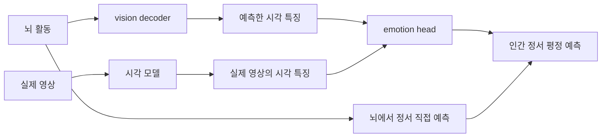

# 장면을 알아보는 뇌 정보로 그 장면의 정서도 설명할 수 있을까?

RP01 · NQ01 · 연구 기획 v2

우리는 장면 속 물체와 상황을 알아보면서 그 장면이 어떤 정서와 관련되는지도 구별한다. 이때 정서와 관련된 뇌 반응은 장면을 표현하는 정보에 이미 들어 있을까, 아니면 다른 뇌 영역의 정보가 더 필요할까? 뇌 반응에서 장면의 시각 정보를 읽어내는 모델에 정서 예측기를 붙여 이 두 설명을 비교한다.

## 이 질문으로 알아내려는 것

시각과 정서에 관한 정보가 어느 뇌 영역에서 함께 나타나는지 조사한다. 물체를 알아보는 정보만으로 충분한지, 행동과 상황을 나타내는 정보까지 필요한지, 시험한 시각 표현으로 설명되지 않는 정서 관련 정보가 다른 영역에 남는지를 구분한다.

## 어떤 설명을 비교하나

| 설명 | 맞다면 관찰할 결과 |
| --- | --- |
| 장면의 물체·행동·상황을 나타내는 뇌 정보가 그 장면의 정서를 설명하는 데도 쓰인다. | 장면 정보를 잘 읽어낼 수 있는 시각 영역에서 뇌→시각 표현→정서 경로의 예측도 잘 된다. 학습에서 보지 않은 물체나 장면 종류로 옮겨도 이 관계가 유지되며, 같은 영역의 뇌 반응을 직접 정서 예측에 넣었을 때 추가되는 이득은 작다. |
| 시각 정보는 장면을 알아보는 데 기여하지만 정서를 설명하려면 다른 뇌 영역의 정보가 더 필요하다. | 시각 표현으로 장면을 잘 구별해도 정서 예측은 불완전하다. 전두·두정 영역 등에서 얻은 뇌 반응을 추가하면, 영상에서 계산한 특징과 시각 영역의 반응만으로 설명하지 못한 정서 평가를 새로운 장면에서도 더 잘 예측한다. |
| 두 예측이 함께 잘 되는 이유는 특정 물체나 장면이 특정 정서 평가와 자주 함께 나타나기 때문이다. | 비슷한 영상이 학습과 평가에 함께 있을 때는 잘 맞지만, 다른 물체 종류나 새로운 상황을 평가하면 뇌→시각 표현→정서 경로의 성능이 크게 낮아진다. 영상 특징만 사용한 예측도 같은 방식으로 실패한다. |

## 뇌에서 무엇을 보고, AI를 어떻게 쓰나

한 참가자가 각 영상을 볼 때 나타난 뇌 활동 패턴을 비교한다. 초기 시각피질, 물체·장면을 처리하는 후두·측두 영역, 여러 종류의 정보를 통합하는 전두·두정 영역을 나누어 분석하고, 시각 영역에 다른 영역의 반응을 더했을 때 어떤 정서 정보가 추가되는지 본다. 실제 자료에 포함된 영역과 반응의 측정 품질을 먼저 확인한다.

1. Horikawa 보유 자료에서 영상별 뇌 반응과 인간이 부여한 정서 평가를 연결한다. 정확한 주석 항목을 확인한 뒤, 뇌 결과를 보기 전에 분석할 정서 평가와 학습·평가 영상 묶음을 정한다.

2. 먼저 실제 영상을 고정된 시각 모델에 넣어 물체와 장면 정보를 담은 숫자 벡터를 얻는다. 이를 시각 표현이라고 부른다. 뇌 반응을 입력받아 이 시각 표현을 예측하는 작은 vision decoder를 학습한다. 새로운 영상을 얼마나 잘 찾아내는지도 확인해 장면 정보를 읽는 능력을 따로 측정한다.

3. 시각 표현을 입력받아 인간의 정서 평가를 예측하는 작은 emotion head를 학습한다. 이 정서 예측기는 실제 영상의 시각 표현으로 학습한 뒤 고정한다. 뇌에서 예측한 시각 표현에도 같은 예측기를 적용한다.

4. 같은 평가 영상에서 세 경로를 비교한다: 뇌→시각 표현→정서, 뇌→정서 직접 예측, 실제 영상→정서 예측. 정서 평가는 어느 경로의 출력으로도 새로 만들지 않으며, 모든 모델은 평가 영상의 뇌 반응과 주석을 학습에 쓰지 않는다.

5. 시각 영역만 쓸 때와 다른 영역을 추가할 때를 비교한다. 직접 예측이 더 잘 되는 영역이 있다면, 단순히 입력 수나 측정 품질이 좋아진 것인지 확인한다. 반대로 시각 표현을 거친 예측이 좋더라도 세 모델의 정확도가 비슷하다는 이유만으로 같은 신경 기제를 쓴다고 결론내리지 않는다. 뇌에서 예측한 시각 표현과 실제 영상의 표현이 다른 분포를 가질 수 있으므로, 학습 자료에서만 정한 보정과 별도의 작은 head를 쓰는 보조 분석도 확인한다. 고정한 head에서만 생기는 실패를 뇌 정보의 부재로 읽지 않는다.

6. 물체·장면 종류가 다른 영상 묶음을 따로 남겨 평가한다. 시각 영역의 정보가 정서 예측에도 계속 유용한지, 다른 영역의 추가 정보가 특히 새로운 상황에서 도움이 되는지를 본다. 물체뿐 아니라 행동·관계를 더 풍부하게 표현한 영상 특징에서도 결과가 유지되는지 확인한다.

## 결과를 어떻게 해석하나

| 관찰 결과 | 과학적 의미 |
| --- | --- |
| 시각 영역에서 장면 구별과 정서 예측이 함께 잘 되고, 새로운 종류의 영상에서도 시각 표현을 거친 예측이 직접 예측에 가까운 수준을 유지한다. | 시험한 장면과 정서 평가에서는 시각 영역에 담긴 장면 정보가 정서 설명에도 충분히 유용하다는 증거다. 뇌가 실제로 우리가 만든 decoder와 emotion head 순서대로 계산한다는 뜻은 아니다. |
| 장면은 잘 구별하지만 정서 예측은 부족하고, 다른 영역의 뇌 반응을 추가하면 새로운 영상의 정서 평가가 더 잘 예측된다. | 시험한 시각 표현을 넘어서는 정서 관련 정보가 추가로 필요하다는 설명을 지지한다. 다만 시각 모델이 행동이나 상황의 중요한 부분을 놓쳤을 가능성도 함께 검토해야 한다. |
| 익숙한 물체·장면에서는 세 경로가 모두 잘 되지만 새로운 내용에서는 함께 실패한다. | 정서 예측이 특정 시각 내용과 정서 평가의 반복적인 연관에 크게 의존한다는 설명을 지지한다. 곧바로 뇌에 일반적인 정서 정보가 없다고 말할 수는 없다. |
| 실제 영상으로는 정서 평가를 예측할 수 있지만 뇌에서 장면 정보를 읽는 단계부터 실패한다. | 현재 측정이나 decoder로 두 신경 설명을 구분하기 어렵다. 시각 정보와 정서 정보가 분리되어 있다는 음성 결과로 취급하지 않는다. |

## 기존 연구에서 더 나아갈 부분

시각 모델로 정서를 예측하는 연구, 영상으로 유발된 정서의 뇌 표현 연구, 뇌에서 영상을 읽어내는 연구는 이미 있다. vision decoder에 분류기를 하나 붙이는 것 자체는 새 발견이 아니다.

같은 영상과 인간 평가에서 세 예측 경로를 비교하고, 시각 영역과 다른 영역의 기여가 새로운 장면에서 어떻게 달라지는지 본다. 이를 통해 장면 정보로 정서 설명이 충분한 경우와 추가 신경 정보가 필요한 경우를 구별한다.

같은 설계를 이미 수행한 근접 연구가 있는지는 추가 확인이 필요하다. 이번 수정에서는 새 원문 검색을 하지 않았으며 기존 문헌의 확인 범위를 유지한다.

## 보유 자료로 시작할 범위

Horikawa의 영상별 뇌 반응과 외부 인간 정서 평가로 시작한다. 개인 내 반복 측정이 있다고 가정하지 않고, 관측한 5명의 결과를 각각 확인한다. Emo-FilM이나 Spacetop은 주석과 반응의 단위를 확인한 뒤 별도 재검증에 사용할 수 있다. NSD에는 정서 라벨이 확인되지 않았고 Mind Captioning의 자료 구조도 미확인이므로 주 분석의 정답으로 사용하지 않는다. 현재 보유본의 경로·배열·주석 항목과 모델 가중치 실행은 확인 전이다.

먼저 할 일: 정서 평가와 영상 종류를 확인할 수 있는 두 내용 묶음을 고른다. 한 묶음에서 학습하고 다른 묶음에서 평가하면서, 시각 영역만 사용한 세 경로와 시각 영역에 전두·두정 영역을 더한 직접 예측을 비교한다. 먼저 작은 모델과 기존 영상 특징으로 시작하고, 실제 영상→정서 예측 및 뇌→장면 구별이 가능한지 함께 확인한다.

## 해석할 때 남는 한계

- 세 경로의 예측 정확도만으로 정보가 같은 뉴런에 담겼다거나 뇌가 같은 계산 순서를 따른다고 입증할 수 없다. 영역별 결과와 새로운 내용에서의 결과를 함께 봐도 결론은 정보의 공유 가능성에 관한 것이다.
- 시각 표현을 거친 예측의 실패는 뇌의 정보 부족보다 시각 모델이나 decoder가 중요한 단서를 놓친 결과일 수 있다.
- 외부 정서 평가는 장면에 대한 인간의 평가이며 스캔 참가자 개인의 순간적인 정서 상태를 직접 측정한 값은 아니다.
- Horikawa의 5명과 제한된 장면에서 얻은 결과를 사람 전체와 모든 정서로 확대하지 않는다.

## 관련 문헌

- [P001 · The neural representation of visually evoked emotion is high-dimensional, categorical, and distributed across transmodal brain regions](https://doi.org/10.1016/j.isci.2020.101060): 시각 자극의 정서와 분산된 뇌 표현을 연결하는 직접 신경과학 선행연구이자 Horikawa 분석의 출발점.
- [P008 · Emotion schemas are embedded in the human visual system](https://doi.org/10.1126/sciadv.aaw4358): 영상의 시각 표현으로 정서를 설명할 수 있다는 근거와, 그 설명이 뇌의 시각 처리와 연결되는지를 묻는 직접 선행연구.
- [P015 · MindEye2: Shared-Subject Models Enable fMRI-To-Image With 1 Hour of Data](https://arxiv.org/abs/2403.11207): 뇌 반응을 시각 표현으로 옮기는 구현의 참고. 해당 모델의 복원 성공을 정서 정보 공유의 증거로 대신하지 않는다.
- [P016 · Reconstructing the Mind's Eye: fMRI-to-Image with Contrastive Learning and Diffusion Priors](https://arxiv.org/abs/2305.18274): 뇌→시각 표현과 후속 영상 생성 경로를 구분하는 방법 근거. 이번 첫 실험에는 영상 생성 자체가 필요하지 않다.
- [P079 · Learning Transferable Visual Models From Natural Language Supervision](https://raw.githubusercontent.com/mlresearch/v139/gh-pages/radford21a/radford21a.pdf): 고정된 시각 표현을 만드는 도구의 근거. 그 모델의 정서 점수는 인간 정서 주석을 대신하지 않는다.

[문헌별 실제 확인 범위](../literature/REVISION_V2_SOURCES.md). 이 제안의 분석 결과는 아직 없다.

[제안 목록](README.md) · [새 질문과 이전 제안의 관계](../revision_v2/CHANGELOG.md)
